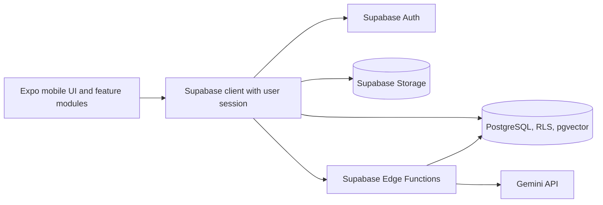
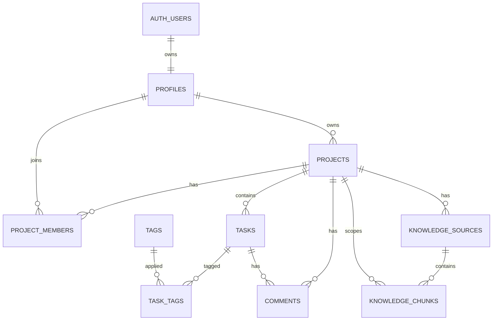

# Architecture Spine — TaskFlow Mobile

## Design Paradigm

Layered client with PostgreSQL as the source of truth for application data and authorization. Mobile UI and feature modules depend on Supabase adapters; Supabase RLS enforces data access; narrowly scoped Edge Functions handle privileged account operations and Gemini calls.

## Invariants & Rules

### AD-1 — Follow the approved native mobile target [ADOPTED]

- **Binds:** all client capabilities; PRD FR-039
- **Prevents:** separately built features targeting incompatible web and mobile runtimes.
- **Rule:** deliver one Expo / React Native application for iOS and Android; use Expo Router for screen navigation. The current Next.js scaffold is not the mobile client.

### AD-2 — PostgreSQL RLS is the authorization boundary [ADOPTED]

- **Binds:** profiles, projects, memberships, tasks, comments, avatars, assistant knowledge.
- **Prevents:** protected information being exposed by a hidden-button-only check or a direct client request.
- **Rule:** enable RLS for every user-accessible table and storage object; authorize project access from the current profile, project owner, active membership, and global administrator role. The client cannot change its global role.

### AD-3 — Keep task transitions and dashboard calculations consistent [ADOPTED]

- **Binds:** task writes and dashboards; PRD FR-012–024.
- **Prevents:** screens calculating different progress values or writes bypassing assignment, lifecycle, and completed-task rules.
- **Rule:** route every task mutation through one database function that checks due date, active profile, project state and assignment (the owner is assignable even without a membership row). Members can update only their assigned task status through allowed transitions; owner/admin field edits must respect completed-task locking. Calculate every dashboard from one shared database read using FR-021–024: exclude cancelled tasks; created=0, in-progress=0.5, completed=1; progress is contribution sum divided by eligible task count and is empty when that count is zero; overdue means past due and neither completed nor cancelled. Expose global counts for created, in-progress, completed, and overdue tasks; do not expose a cancelled-task counter.

### AD-4 — Scope assistant retrieval to the authorized project [ADOPTED]

- **Binds:** question handling, vector search, cited sources; PRD FR-025–032.
- **Prevents:** a semantic search returning a similar passage from another project.
- **Rule:** the assistant Edge Function verifies the caller and current access, derives the allowed `project_id` from that verified request, embeds the question through `EmbeddingProvider`, retrieves only matching project chunks under RLS, then calls `TextGenerator`. Enforce a composite project/source relationship so a chunk cannot cite a source from another project. Never accept a privileged service key from the mobile app.

### AD-5 — Put privileged credentials and account administration on the server [ADOPTED]

- **Binds:** invitations, account disable/reactivation, AI provider calls.
- **Prevents:** an extracted mobile binary revealing credentials or allowing users to promote themselves.
- **Rule:** keep Supabase service-role and Gemini API keys in Edge Function secrets. Persist the mobile Auth session using Expo SecureStore. Every Edge Function validates caller identity, active profile, and current `session_id` before reading protected data or using privileged credentials; admin operations also verify the administrator role. On deactivation set `profiles.active=false` and `disabled_at`. RLS and Edge Functions use one narrowly privileged, read-only SQL helper to verify that the JWT `session_id` maps to an Auth session created after `disabled_at`; derive user/session IDs only from the verified JWT, return only a boolean, keep the function outside the exposed API schema, and pin its `search_path`. The app clears its local session on rejection. This keeps pre-deactivation sessions blocked after reactivation without claiming that an outstanding JWT has been cryptographically revoked.

### AD-6 — Keep project and task lifecycle reversible as specified [ADOPTED]

- **Binds:** project and task lifecycle; PRD FR-007–020.
- **Prevents:** destructive deletion losing the audit context needed by team members.
- **Rule:** never physically delete projects; cancellation retains the project and restricts visibility to owner/admin. Permit physical task deletion only while created, never started, and without comments; otherwise cancel and retain prior status for reactivation.

### AD-7 — Keep provider calls and state freshness explicit [ADOPTED]

- **Binds:** mobile reads, assistant, error handling; PRD FR-018, FR-030–032, UX state patterns.
- **Prevents:** exposed API keys, silent stale views, or UI claims of live updates.
- **Rule:** all Gemini calls originate server-side; lists and dashboards refresh manually; errors preserve editable input and identify stale data; authorization failures remove protected content from the view.

### AD-8 — Keep generation and embedding providers independently replaceable

- **Binds:** assistant answers, knowledge indexing, model configuration; PRD FR-030–032.
- **Prevents:** replacing one AI provider from requiring mobile or business-logic changes, or tying generation and embeddings to one vendor.
- **Rule:** expose separate server-side `TextGenerator` and `EmbeddingProvider` interfaces; provider-specific SDKs and model names remain inside their adapters. Changing embedding model requires full corpus re-embedding.

### AD-9 — Use the verified demonstration deployment envelope

- **Binds:** initial hosting and test builds.
- **Prevents:** a builder adding an unnecessary web host or production environment to the demonstration MVP.
- **Rule:** deploy Supabase in `eu-west-3` (Paris), use Expo EAS for installable cloud builds, and target 10 accounts / 5 concurrent users. Production operations, app-store distribution, and additional environments remain deferred.

### AD-10 — Keep project, membership, and comment writes within shared rules

- **Binds:** project lifecycle, project membership, project/task comments; PRD FR-006–011, FR-019–020.
- **Prevents:** separate screens or direct requests applying different role, visibility, or lifecycle rules.
- **Rule:** route project close/reopen/cancel/reactivate and membership add/remove through transactional PostgreSQL functions with role and active-account checks. Enforce comment create/edit/delete rights in the database: members may comment only where they can see the project; only the author, owner, or administrator may edit/delete; comments remain allowed on closed/cancelled projects and cancelled tasks where the PRD permits visibility.

### AD-11 — Share one client/server contract for assistant and errors

- **Binds:** mobile-to-Edge Function requests and responses; PRD FR-027–032, FR-036–037.
- **Prevents:** screens and server functions interpreting citations, no-answer results, or failures differently.
- **Rule:** keep one versioned TypeScript contract for Edge Function payloads and response envelopes. Success responses use named fields; failures use the stable error codes below. Assistant responses contain an answer and zero or more citations with source identity, display name, excerpt, and an in-app destination only when one exists; a no-source result is explicit. Validate the contract at the function boundary.

### AD-12 — Keep account and assignment identity authoritative

- **Binds:** profiles, roles, project membership and task assignment; PRD FR-003, FR-008, FR-011, FR-033–035.
- **Prevents:** profile labels or cached membership state becoming a second source of truth.
- **Rule:** Supabase Auth owns login identity; `profiles` owns editable names, avatar reference, and active state; global administrator role is server-owned. Project membership is authoritative in `project_members`; task assignment stores a profile ID. Membership removal clears affected assignment in the same transaction and immediately revokes project/assistant access. Account deactivation retains membership and assignment IDs, derives the disabled display from profile state, and restores access to prior tasks on reactivation.

## Consistency Conventions

| Concern | Convention |
|---|---|
| Identifiers and dates | UUID primary/foreign keys; timestamps in UTC; project/task deadlines stored as date-only values. |
| Project status | `active`, `closed`, `cancelled`; preserve previous close date on reopen, clear it on reactivation from cancellation. |
| Task status | `created`, `in_progress`, `completed`, `cancelled`; canceled tasks retain previous status. |
| Mutations | Database is authoritative; task, project lifecycle, and membership writes use transactional functions; refresh dashboard after confirmed writes. |
| Comments | `comments` references exactly one project or task; database constraint enforces one target. RLS/function checks apply the PRD edit/delete and visibility rules. |
| Tags | Project-owned tag; `task_tags` links tasks and tags only within the same project. |
| API/error contract | Versioned Edge Function TypeScript contract; stable codes: `AUTH_REQUIRED`, `FORBIDDEN`, `VALIDATION_ERROR`, `NOT_FOUND`, `CONFLICT`, `RATE_LIMITED`, `AI_UNAVAILABLE`. |
| Provider configuration | Server secrets only; model names and embedding dimensions are server configuration, never mobile constants; generation and embedding adapters stay separate. |

## Stack

| Name | Version |
|---|---|
| Expo SDK | 58.0.0 |
| React Native | 0.88.0 |
| React | 19.3.0 |
| Node.js | 24 LTS |
| TypeScript | 5.x; exact version comes from the Expo 58 starter and mobile lockfile |
| Expo SecureStore | 58.0.2 |
| Supabase JS | `^2.118.0` range already specified in package.json |
| PostgreSQL | Supabase managed PostgreSQL |
| Vector extension | pgvector, Supabase managed |
| Server functions | Supabase Edge Runtime (Deno-compatible TypeScript) |
| Text generation | Gemini `gemini-3.5-flash-lite` (proposed candidate) |
| Embeddings | Gemini `gemini-embedding-2`, 768 dimensions (proposed candidate) |

## Structural Seed

## Capability and Screen → Architecture Map

| Capability / Screen | Owning building blocks | Governed by |
|---|---|---|
| Login / password reset; invitations; profile and account administration (FR-001–004, FR-033–035) | Supabase Auth; `profiles`; optional Storage avatar; admin Edge Function; Expo login, profile and account screens | AD-2, AD-5, AD-12 |
| Projects list; project detail; project members (FR-005–011) | PostgreSQL `projects` / `project_members`; project lifecycle and membership functions; Expo project/detail/member screens | AD-2, AD-6, AD-10, AD-12 |
| Task list / My Tasks; project/task forms; comments and filters (FR-012–020) | PostgreSQL `tasks`, `tags`, `task_tags`, `comments`; task mutation function; Expo task/form/comment screens | AD-2, AD-3, AD-6, AD-10, AD-12 |
| Home / dashboard (FR-021–024) | Shared PostgreSQL dashboard query/view; Expo Home screen | AD-3, AD-7 |
| Project assistant and sources (FR-025–032) | Knowledge source/chunk tables and pgvector; assistant Edge Function; Gemini adapters; Expo assistant screen | AD-2, AD-4, AD-5, AD-8, AD-11 |
| Forms, French interface, accessibility, errors, session handling (FR-036–037) | Expo shared form/state/accessibility components; Supabase Auth and stable Edge error contract | AD-1, AD-5, AD-7, AD-11 |
| Demonstration flow and installable build (FR-038–039) | Fictional corpus in `supabase/seed.sql`, reset via `supabase/reset-demo.sql`; Expo app; EAS Build (Expo Build) | AD-1, AD-4, AD-9 |
| Manual verification scenarios for three roles and RLS (FR-040) | Versioned checklist at `docs/verification/manual-test-scenarios.md` | AD-2, AD-3, AD-10 |
| Vibe-coding decision and verification log (FR-041) | Versioned log at `docs/development/vibe-coding-log.md` | AD-1 |

## Deferred

- [ASSUMPTION] Email delivery provider for invitations and password resets; start with Supabase's built-in sending for the demo and revisit when limits require SMTP.
- Final generation model after a small French question quality / latency / cost comparison; `gemini-3.5-flash-lite` is the initial candidate.
- Embedding chunk size, retrieval threshold, and manual answer-quality protocol; settle against the fictional demo corpus before loading it.
- Email sending provider for invitations and password resets; begin with Supabase's built-in sending and add SMTP only if required.
- Minimum supported mobile OS versions, based on the devices available for manual demonstration.
- Exact Storage bucket, image limits, and avatar visibility policy; avatar upload is optional in the PRD and is not required until that feature is selected.
- Seed and reset data live in `supabase/seed.sql` and `supabase/reset-demo.sql`; validate these paths against the Expo/Supabase implementation workspace before loading the demo corpus.
- Whether project membership may be changed while a project is closed or cancelled; the PRD specifies the actors and active account requirement, but not this lifecycle edge. Decide before implementing those controls.
- Exact install/distribution method for iOS demo devices; Apple Developer membership is not assumed unless the selected path requires it.
- Provider billing and usage limits at implementation time. As checked 2026-11-04: Supabase Free can pause after a week of low activity; Pro starts at $25/month. EAS Free includes 15 iOS and 15 Android cloud builds per month; Starter is $19/month. Gemini billing depends on selected model and call volume. Apple Developer is $99/year for distribution paths that require membership. Recheck official pricing before enabling paid usage.
- The €0–25/month starting budget is indicative. Confirm currency conversion, taxes, and whether it covers an always-on Supabase project before upgrading; set usage alerts/limits before enabling paid AI calls.
- Pin TypeScript to the version selected by the Expo SDK 58 mobile starter and commit that app's lockfile; the existing Next.js lockfile is not the mobile app's dependency contract.
- Performance acceptance protocol: reference device per platform, network, fictional dataset, and repeatable French question set; the PRD targets <3s for usual screens and <10s for 95th-percentile AI responses.
- Production environment, backups/restore operations, monitoring policy, incident handling, privacy/compliance package, and app-store releases.
- iOS physical-device testing requires Apple Developer membership; Android APK distribution remains the no-membership path.
