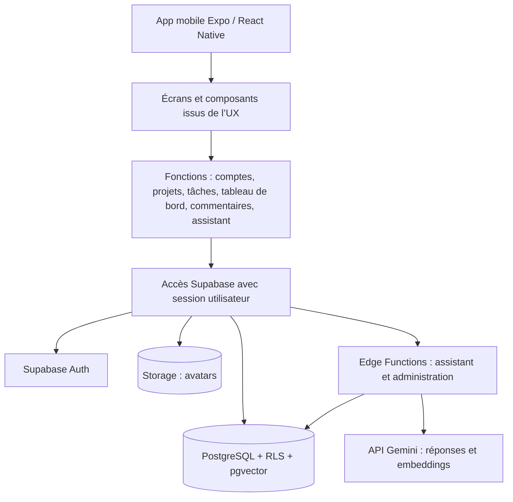
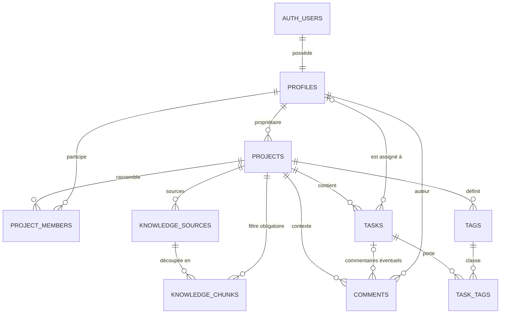

# Architecture proposée — TaskFlow Mobile

**À valider par le commanditaire.** Cette proposition couvre le MVP mobile de démonstration : 10 comptes prévus, jusqu’à 5 personnes connectées en même temps, budget initial de 0 à 25 €/mois, aucune publication en boutique.

## Décisions en bref

- Application iOS et Android : **Expo SDK 58 avec React Native**, en TypeScript.
- Données, comptes et accès : **Supabase Auth et PostgreSQL**, protégés par les règles RLS de la base.
- Assistant et opérations réservées à l’administration : **Supabase Edge Functions**, qui appellent l’API **Gemini** côté serveur.
- Recherche documentaire : **pgvector** dans la même base Supabase; les connaissances de démonstration sont fictives et propres à chaque projet.
- Hébergement de départ : Supabase Free et Expo EAS Free; passer à Supabase Pro si la démonstration doit rester disponible sans mise en veille.

## Pourquoi ces outils ?

| Outil retenu | Rôle | Justification en une phrase |
|---|---|---|
| Expo SDK 58, React Native 0.88, React 19.3 | Application mobile iOS/Android | Expo prépare les deux applications natives à partir d’un même projet et donne un chemin de départ documenté. |
| TypeScript 5.x | Langage de l’application et des fonctions serveur | Il signale beaucoup d’erreurs de forme pendant l’écriture, avant qu’elles n’arrivent à l’écran. |
| Expo Router | Écrans et navigation | Ses routes suivent les fichiers, ce qui rend les quatre onglets prévus faciles à retrouver. |
| Expo SecureStore | Jetons de session mobiles | Il stocke les jetons dans le trousseau iOS ou le coffre Android au lieu d’un fichier ordinaire de l’application. |
| Supabase Auth | Connexion, invitation, session et mot de passe | Il fournit les comptes et les sessions sans construire un système de mots de passe soi-même. |
| Supabase PostgreSQL | Données des projets et des équipes | Une base relationnelle relie clairement utilisateurs, projets, tâches et commentaires. |
| RLS (règles d’accès dans PostgreSQL) | Cloisonnement par utilisateur et projet | La base vérifie chaque ligne demandée, y compris si quelqu’un contourne l’interface mobile. |
| Supabase Storage | Avatars facultatifs | Les images restent auprès des comptes et peuvent être protégées avec les mêmes règles d’accès. |
| pgvector | Recherche parmi les sources d’un projet | Il compare les nombres produits par Gemini dans la même base que les projets, en conservant le filtre par projet. |
| Supabase Edge Functions (TypeScript/Deno) | Assistant, invitations, désactivation de comptes | Ces petits programmes côté serveur gardent les clés secrètes hors du téléphone et regroupent les opérations sensibles. |
| Interface `TextGenerator` + Gemini `gemini-3.5-flash-lite` | Réponses de l’assistant | Le serveur peut remplacer Gemini par un autre générateur sans changer l’écran ni la logique de recherche. |
| Interface `EmbeddingProvider` + Gemini `gemini-embedding-2`, dimension 768 | Index et recherche des sources | Ce connecteur permet de changer séparément le modèle qui transforme les textes en vecteurs de nombres; 768 nombres prennent moins de place que le format maximal. |
| Expo EAS Build | Création de fichiers installables iOS/Android depuis le cloud | Il évite d’installer et d’entretenir les outils natifs Apple et Android sur le PC Windows. |

Les versions Expo/React Native et Gemini sont vérifiées dans leurs documentations officielles au 2 novembre 2026. L’application contient l’URL publique Supabase, la clé publishable et la session de la personne, mais aucune clé privée; les clés Gemini et Supabase privilégiées restent côté serveur.

## Briques de l’application

1. **Application mobile.** Expo Router organise en haut les onglets Accueil, Projets, Mes tâches et Assistant; ouvrir l’assistant conserve le projet choisi. Les mêmes écrans s’adaptent à la largeur tablette. Le thème et les repères visuels suivent `DESIGN.md`.
2. **Fonctions métier sur le téléphone.** Les écrans présentent l’état de chargement, le résultat et les erreurs; ils gardent les formulaires en cours si le réseau échoue. Ils n’accordent jamais de droits eux-mêmes.
3. **Accès direct à Supabase.** Le client lit les données et demande les modifications simples avec la session de la personne; PostgreSQL et RLS décident si l’opération est permise.
4. **Fonctions serveur.** Chaque fonction vérifie d’abord le jeton courant, l’état actif du profil et la validité de sa session, avant de lire des données ou d’effectuer une action privilégiée. `assistant-answer` vérifie ensuite l’accès au projet, transforme la question en embedding, recherche les passages autorisés puis utilise `TextGenerator` pour rédiger la réponse. `EmbeddingProvider` et `TextGenerator` sont deux interfaces séparées; leurs adaptateurs Gemini ne sont pas référencés par les écrans métier. `index-demo-knowledge` prépare les embeddings des sources fictives. `admin-accounts` vérifie aussi le rôle administrateur avant d’inviter, désactiver ou réactiver un compte.
5. **Base et fichiers.** PostgreSQL stocke les données relationnelles et les passages vectorisés; Storage garde les avatars facultatifs.
6. **Services externes.** Gemini produit les réponses et embeddings. EAS fabrique les builds installables; il n’héberge ni l’API métier ni les données.

Les lectures et mises à jour de listes restent manuelles, par bouton « Actualiser » ou geste tirer-vers-le-bas; les vues montrent l’heure de la dernière lecture. Aucune connexion temps réel, aucun serveur web Next.js et aucun service d’hébergement web séparé ne sont nécessaires pour cette cible.

**Accessibilité à respecter dans chaque écran :** VoiceOver et TalkBack doivent nommer les commandes, champs, statuts et erreurs; le texte système peut s’agrandir; les cibles tactiles mesurent au minimum 44 pt sur iOS et 48 dp sur Android; la couleur seule ne transmet jamais un statut; l’application respecte « Réduire les animations ».

## Données principales et liens

| Donnée | Champs et règle importants |
|---|---|
| `auth.users` et `profiles` | Le service Auth détient l’adresse et le secret de connexion; `profiles` contient prénom, nom, avatar et indicateur actif. Le rôle administrateur ne peut pas être modifié par le client. |
| `projects` | Nom, dates, état (`actif`, `clôturé`, `annulé`) et `owner_id`. Un projet n’est jamais effacé physiquement; les transitions gardent ou effacent la date de clôture selon le PRD. |
| `project_members` | Liens uniques entre un projet et un profil membre; retirer ce lien retire l’accès sans supprimer les tâches passées. Le propriétaire est identifié par `projects.owner_id`. |
| `tasks` | Projet, titre, description, échéance obligatoire, priorité, état, personne assignée facultative, statut précédent pour restaurer une tâche annulée. Une affectation vise un membre actif du projet ou son propriétaire, même si celui-ci n’a pas de ligne dans `project_members`. |
| `tags` et `task_tags` | Les tags appartiennent à un projet; `task_tags` relie plusieurs tags à une tâche sans mélanger les projets. |
| `comments` | Auteur, texte, projet et `task_id` facultatif. Si `task_id` est renseigné, la tâche doit appartenir au même projet. |
| `knowledge_sources` et `knowledge_chunks` | Nom, extrait, lien éventuel, `project_id`, source et embedding de 768 nombres. Une contrainte composée lie chaque extrait à sa source dans le même projet; chaque recherche filtre encore sur l’identifiant du projet autorisé. |

**Calcul du tableau de bord :** il est calculé à partir des tâches non annulées. Une tâche créée vaut 0, en cours 0,5, terminée 1; une échéance passée est en retard sauf si la tâche est terminée ou annulée. Si le dénominateur est nul, la progression reste vide.

**Transitions de tâche :** un membre assigné peut passer de « créée » à « en cours » ou directement à « terminée », puis de « terminée » à « en cours ». Seul le propriétaire ou l’administrateur peut annuler ou réactiver une tâche; la réactivation restaure son état précédent. Les champs d’une tâche terminée restent verrouillés jusqu’à son retour à « en cours ».

## Cibles de performance du MVP

Le PRD donne deux objectifs provisoires : ouvrir les écrans usuels en moins de 3 secondes et répondre à l’assistant en moins de 10 secondes pour 95 % des questions. Avant de les traiter comme des critères d’acceptation, fixer un appareil de référence pour chaque système, le jeu de données fictives, une connexion Internet de référence et une série stable de questions en français; répéter les mêmes mesures après chaque changement de modèle ou de recherche.

## Petit lexique

- **RLS :** règles que la base applique pour décider qui peut lire ou modifier chaque ligne.
- **Jeton de session :** preuve temporaire que la personne s’est connectée; l’application le conserve dans le stockage sécurisé du téléphone.
- **Fonction serveur (Edge Function) :** petit programme hébergé par Supabase qui exécute une opération protégée sans livrer les clés privées au téléphone.
- **Transaction :** groupe de changements que la base valide ensemble; si l’un échoue, aucun changement du groupe n’est enregistré.
- **Vecteur / embedding :** liste de nombres qui représente le sens d’un texte pour retrouver des textes proches; `pgvector` ajoute leur comparaison à PostgreSQL.
- **Build installable :** fichier de l’application qu’on peut installer pour l’essayer, sans publier l’application dans une boutique.

Le tableau affiche explicitement les deux progressions (globale et personnelle) et les compteurs créées, en cours, terminées et en retard; il ne crée pas de compteur annulées. `profiles.first_name` et `profiles.last_name` sont obligatoires.

## Comptes, droits et protection des données

| Opération | Administrateur | Propriétaire du projet | Membre |
|---|---|---|---|
| Comptes | Invite, désactive et réactive les comptes | — | Gère son profil et son mot de passe |
| Projets | Tous les projets; tous les droits de propriétaire | Crée et gère ses projets | Lit les projets où il est membre |
| Membres | Ajoute ou retire des comptes actifs de tout projet | Ajoute ou retire des comptes déjà actifs de son projet | Ne modifie pas les membres |
| Tâches | Gère toutes les tâches | Gère les tâches de ses projets | Ne change que le statut d’une tâche active qui lui est assignée |
| Commentaires | Droits du propriétaire | Modifie/supprime les siens et ceux du projet | Ajoute; modifie/supprime les siens |
| Assistant | Recherche dans tous les projets | Recherche dans ses projets | Recherche dans les projets dont il est membre |

Règles communes proposées :

- **Une seule source d’autorisation :** RLS protège projets, membres, tâches, commentaires, avatars et passages de l’assistant; masquer un bouton dans l’application ne constitue pas une protection.
- **Session mobile :** Supabase Auth persiste la session dans Expo SecureStore; les jetons restent dans le trousseau sécurisé du système et sont effacés à la déconnexion.
- **Le serveur contrôle les changements sensibles :** les rôles sont lus en base; une fonction PostgreSQL applique chaque changement de tâche dans une transaction. Elle vérifie l’échéance obligatoire, que l’assigné est un compte actif et soit membre du projet soit propriétaire, le statut actif du projet, les transitions permises et le verrouillage des champs d’une tâche terminée jusqu’à son retour en cours. Un membre ne peut modifier que le statut d’une tâche qui lui est assignée.
- **Les opérations d’administration sont séparées :** seules les fonctions serveur utilisent la clé Supabase privilégiée; elles vérifient d’abord que l’appelant est administrateur. Cette clé n’est jamais livrée au téléphone.
- **Révocation immédiate :** à la désactivation, la base marque le compte inactif et RLS bloque aussitôt ses demandes. Une petite fonction SQL en lecture seule et aux droits limités compare l’identifiant de la personne et de la session du jeton courant à la date de création de cette session dans Auth. Elle n’accepte aucun identifiant fourni par l’écran et ne renvoie qu’un oui/non. Après réactivation, les anciennes sessions restent bloquées et une nouvelle connexion est nécessaire. Le jeton peut rester valide jusqu’à expiration, mais ne permet pas de lire ni modifier les données protégées. Les fonctions serveur appliquent le même contrôle avant d’utiliser leurs droits privilégiés. L’application efface les données en mémoire et demande une nouvelle connexion après ce refus. Retirer un membre supprime l’accès au projet et à son assistant à la requête suivante.
- **Projets annulés et clôturés :** un projet annulé n’est visible que par son propriétaire et les administrateurs; un projet clôturé est en lecture seule, hors commentaires. Les commentaires suivent les mêmes règles de visibilité que leur projet ou leur tâche.
- **Assistant limité aux preuves :** `EmbeddingProvider` transforme la question et `TextGenerator` reçoit seulement les extraits retrouvés dans le projet auquel l’appelant a accès; chaque source affichée comporte son nom et l’extrait utilisé, plus un lien ouvrable dans l’application lorsqu’il existe. Une contrainte composée interdit de rattacher un extrait à une source d’un autre projet. L’assistant dit qu’aucune réponse n’a été trouvée si rien n’est assez pertinent; le seuil se choisit avec des questions françaises positives et sans réponse sur le corpus fictif, avant validation manuelle.

### Erreurs et retour à l’utilisateur

La fonction serveur renvoie une erreur courte et stable (`AUTH_REQUIRED`, `FORBIDDEN`, `VALIDATION_ERROR`, `NOT_FOUND`, `CONFLICT`, `RATE_LIMITED`, `AI_UNAVAILABLE`). L’application la traduit en français sans afficher la requête SQL, la clé, la trace technique ou le texte d’un autre projet. Une erreur réseau conserve la saisie, signale que les données visibles sont anciennes et propose « Réessayer ». Un refus de droit retire immédiatement le contenu protégé de l’écran. Une requête Gemini échouée garde la question et permet de recommencer.

## Hébergement et coût au démarrage

| Service | Départ proposé | Coût fixe indicatif | Quand payer ? |
|---|---|---:|---|
| Supabase Free, région Paris (`eu-west-3`) | Auth, PostgreSQL, RLS, Storage et Edge Functions | **0 $/mois** | Convient au développement et à une démo utilisée régulièrement; un projet gratuit est mis en pause après une semaine d’inactivité. |
| Supabase Pro | Même projet sans mise en pause automatique | **25 $/mois** | À choisir si le lien de démo doit rester prêt à tout moment; le plan comprend des crédits de calcul pour un petit serveur. |
| Gemini API | Un modèle Flash-Lite pour réponses, Embedding 2 pour index | **0 $ au quota gratuit**, puis facturation à l’usage | Flash-Lite : 0,30 $ par million de morceaux de texte reçus et 2,50 $ par million générés. Embedding 2 : 0,20 $ par million de morceaux traités. Un « jeton » est un petit morceau de texte; le coût varie avec la longueur des questions, sources et réponses. |
| Expo EAS Free | Builds cloud limités pour essais | **0 $ au quota gratuit** | Un abonnement n’est utile que si les quotas gratuits ou la vitesse de build ne suffisent plus. |
| Apple Developer Program | Signature et installation privée sur iPhone/iPad physiques | **99 $/an** (environ 8,25 $/mois) | Nécessaire pour distribuer un build iOS privé sur des appareils physiques; ce coût n’existe pas pour installer un APK Android. |

**Estimation pratique :** démarrer à **0 $/mois de services fixes**, plus les appels Gemini si le quota gratuit est dépassé. Pour une démonstration toujours disponible, prévoir **25 $/mois** pour Supabase Pro (environ **22,5 €/mois** au taux BCE du 29 octobre 2026), plus l’usage Gemini; le compte Apple annuel représente environ **7,4 €/mois** en moyenne et s’ajoute seulement si l’essai iOS se fait sur des appareils physiques. Les montants sont hors taxes et frais de conversion bancaire; les offres et tarifs peuvent changer. Les limites gratuites sont des quotas, pas une promesse de disponibilité.

La région Paris est choisie pour rapprocher la base de l’équipe et y placer les données de démonstration. Cette localisation ne constitue pas, à elle seule, une certification de conformité réglementaire. Expo EAS produit les binaires, Supabase héberge le backend; la démo n’exige ni Vercel ni déploiement du squelette Next.js.

## Hypothèses et questions à valider

Ces hypothèses sont visibles afin de pouvoir les corriger avant la conception détaillée.

- **[HYPOTHÈSE]** Le propriétaire est unique par projet (`projects.owner_id`); les autres membres sont dans `project_members`. Le propriétaire garde ses droits et peut recevoir une tâche même sans ligne d’appartenance membre.
- **[HYPOTHÈSE]** Expo SecureStore convient au stockage de session Supabase; confirmer la taille réelle d’une session et du jeton sur les comptes de démonstration avant de figer l’adaptateur, car le stockage natif peut refuser de grandes valeurs.
- **[HYPOTHÈSE]** L’équipe utilise d’abord l’envoi d’e-mails intégré de Supabase pour invitations et réinitialisations. Un fournisseur SMTP dédié peut être ajouté si les limites de démonstration deviennent insuffisantes; le choix du fournisseur reste ouvert.
- **[HYPOTHÈSE]** `gemini-3.5-flash-lite` est le premier candidat pour la génération, sous réserve d’un essai manuel des questions françaises prévues au PRD avant de figer le modèle. Les questions pertinentes et non pertinentes servent aussi à régler le seuil qui déclenche la réponse « source introuvable ».
- **[HYPOTHÈSE]** Les données utilisées dans Gemini restent fictives, conformément au PRD; aucun document réel ou contenu sensible de projet n’est envoyé dans le forfait gratuit.
- **[HYPOTHÈSE]** Les essais Android utilisent un APK installable. Un essai iOS sur appareils physiques pourra demander l’adhésion Apple à 99 $/an; cela porte le coût total au-delà de la limite mensuelle si Supabase Pro est également activé.
- **[À confirmer plus tard]** Les trois comptes de démonstration (administrateur, propriétaire, membre) et les scénarios manuels du PRD sont les données de départ; aucune importation libre de fichiers n’est prévue.
- **[À confirmer plus tard]** Les politiques de conservation des journaux, la production, la sauvegarde de continuité et le déploiement multi-environnements sont hors de ce MVP de démonstration.

## Écart avec le dépôt actuel

Le dépôt contient actuellement Next.js et `@supabase/supabase-js`, mais le PRD et l’UX demandent une application native React Native et aucune interface navigateur. Cette architecture suit les documents produit validés : le squelette Next.js n’est donc pas la base technique à prolonger pour l’application mobile. Le remplacer ou créer un projet Expo est une décision de réalisation ultérieure; aucun code n’est modifié dans cette étape.

## Sources officielles consultées

- [Expo — créer un projet et modèles recommandés](https://docs.expo.dev/get-started/create-a-project/) et [référence SDK 58 / React Native](https://docs.expo.dev/versions/latest/)
- [Expo — stockage sécurisé natif](https://docs.expo.dev/versions/latest/sdk/securestore/)
- [Expo — builds installables EAS](https://docs.expo.dev/build/introduction/), [distribution interne](https://docs.expo.dev/build/internal-distribution/) et [tarifs EAS](https://expo.dev/pricing)
- [Supabase — tarifs](https://supabase.com/pricing), [régions disponibles](https://supabase.com/docs/guides/platform/regions) et [Edge Functions](https://supabase.com/docs/guides/functions)
- [Supabase — mise en veille des projets gratuits](https://supabase.com/kb/faqs/platform/free-project-pausing)
- [Supabase — sessions et jetons](https://supabase.com/docs/guides/auth/sessions)
- [Supabase — champs des jetons](https://supabase.com/docs/guides/auth/jwt-fields)
- [Supabase — règles RLS](https://supabase.com/docs/guides/database/postgres/row-level-security) et [fonctions SQL](https://supabase.com/docs/guides/database/functions)
- [Google — tarifs Gemini API](https://ai.google.dev/gemini-api/docs/pricing) et [modèles d’embeddings](https://ai.google.dev/gemini-api/docs/embeddings)
- [Apple — adhésion au programme développeur](https://developer.apple.com/programs/)
- [Node.js — versions prises en charge](https://nodejs.org/en/about/previous-releases)
- [BCE — taux EUR/USD](https://www.ecb.europa.eu/stats/policy_and_exchange_rates/euro_reference_exchange_rates/html/index.en.html) (taux du 29 octobre 2026 utilisé pour l’ordre de grandeur)

---

**Validation demandée :** confirmer les droits décrits, le coût acceptable pour une démo toujours disponible, et si un build iOS sur appareil physique est nécessaire au MVP.
